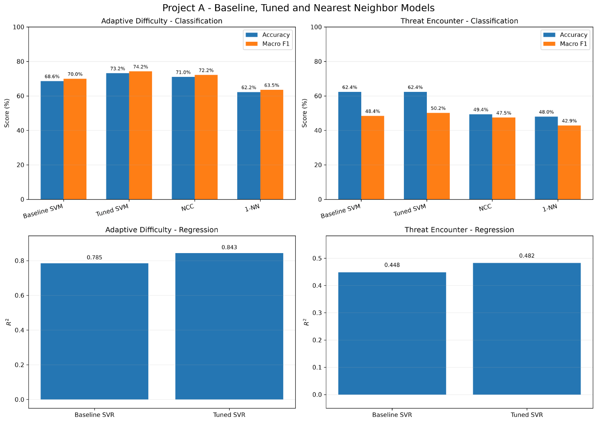

# Horror Game Telemetry & Machine Learning

## Overview

This project explores the application of Machine Learning techniques to horror game telemetry, focusing on player difficulty adaptation and threat encounter prediction/categorization.

The main goal is to investigate how gameplay-related features can be used to model difficulty levels and threat-related events, and to compare the performance of different machine learning algorithms across classification and regression tasks.

The project combines synthetic gameplay telemetry datasets, preprocessing pipelines, cross-validation, baseline model evaluation, hyperparameter tuning, and comparative analysis.

## Project Scope

The project focuses on two core aspects of horror game gameplay:

- **Adaptive Difficulty:** Modeling gameplay difficulty based on telemetry features, with the goal of predicting difficulty categories and recommended difficulty values.
- **Threat Encounters:** Modeling threat-related gameplay events, focusing on encounter categorization and predicting the time until the next threat event.

The experiments are conducted using synthetic telemetry data. They are intended to investigate model behavior, performance, and suitability for potential game systems rather than to represent real player behavior.

## Datasets

Two datasets are used in Project A:

| Dataset | Samples | Features | Classification Target | Regression Target |
|---|---:|---:|---|---|
| Adaptive Difficulty | 30,000 | 16 | `difficulty_category` | `recommended_difficulty` |
| Threat Encounter | 3,000 | 15 | `encounter_category` | `time_to_next_threat_event` |

The datasets contain gameplay-related features designed to represent different aspects of the game state and player experience.

## Prediction Tasks

Each dataset is investigated through two Machine Learning tasks.

### 1. Classification

Classification models are used to predict discrete gameplay categories.

- **Adaptive Difficulty:** Predict the appropriate difficulty category.
- **Threat Encounter:** Predict the threat encounter category.

### 2. Regression

Regression models are used to predict continuous gameplay-related values.

- **Adaptive Difficulty:** Estimate the recommended difficulty value.
- **Threat Encounter:** Estimate the time until the next threat event.

## Machine Learning Models

The project evaluates and compares different model families to investigate their predictive performance and behavior.

### Support Vector Machines

SVM-based models are evaluated using different kernel configurations:

- Linear
- Polynomial
- Radial Basis Function (RBF)
- Combined kernel

Both classification and regression variants are investigated:

- **SVM** for classification
- **SVR** for regression

Experiments include baseline configurations as well as hyperparameter-tuned models.

### Nearest Neighbor Methods

Additional classification models are included as comparison baselines:

- **1-Nearest Neighbor (1-NN):** Classifies samples based on their nearest training instance.
- **Nearest Class Centroid (NCC):** Assigns samples to the class whose centroid is closest in feature space.

These models provide alternative approaches to classification and help evaluate how different learning strategies perform on the telemetry datasets.

## Experimental Methodology

The evaluation methodology is designed to provide a consistent comparison between models.

- **5-fold cross-validation**
- Shuffled data splits with a fixed random seed (`42`)
- Feature standardization using `StandardScaler`
- Scaling fitted exclusively on training folds to avoid data leakage
- Consistent evaluation splits across model comparisons
- Baseline and tuned model evaluation
- Hyperparameter selection through inner cross-validation

Hyperparameter tuning is performed using a 3-fold inner cross-validation process. Classification models are tuned using Macro F1, while regression models are tuned using R².

## Evaluation Metrics

### Classification

- **Accuracy:** Overall proportion of correctly classified samples.
- **Macro F1-score:** Average F1-score across classes, treating each class equally regardless of its frequency.

### Regression

- **R² (Coefficient of Determination):** Measures the proportion of variance explained by the model.
- **MAE (Mean Absolute Error):** Measures the average absolute prediction error.
- **RMSE (Root Mean Squared Error):** Penalizes larger prediction errors more strongly.

Confusion matrices are also generated for classification experiments to provide additional insight into class-level prediction behavior.

## Project A — Model Evaluation & Comparison

Project A focuses on evaluating and comparing SVM/SVR kernel configurations and nearest-neighbor classification methods.

The experiments investigate:

- Baseline vs. tuned model performance
- The effect of different kernel configurations
- Performance across different training dataset sizes
- Classification vs. regression performance
- Comparisons between SVM-based and nearest-neighbor approaches
- The relative importance of Accuracy and Macro F1 in classification
- Regression performance using R², MAE, and RMSE

Comparative visualizations are generated to summarize the results across datasets and tasks.
The following figure showcases the comparison of the results across 30k samples of Dataset 1 and 3k samples of Dataset 2

## Goals

The broader goals of this project are to:

1. Investigate how Machine Learning can support horror game difficulty modeling.
2. Explore threat encounter categorization and threat timing prediction.
3. Compare different Machine Learning algorithms under a consistent evaluation methodology.
4. Study the impact of hyperparameter tuning on model performance.
5. Identify strengths, weaknesses, and trade-offs between model families.
6. Establish an experimental foundation for future gameplay telemetry modeling.

## Limitations

- The datasets are synthetic and do not represent actual player telemetry.
- Model performance reflects the characteristics of the generated datasets.
- Results should not be interpreted as evidence of real-world player behavior or production-ready game balancing.
- Further validation using real gameplay telemetry would be required before applying these models to a live game.

## Future Work

Potential future directions include:

- Exploring additional Machine Learning algorithms.
- Investigating dimensionality reduction and feature-space transformations.
- Expanding the experimental framework to additional gameplay prediction tasks.
- Evaluating models using real or more realistic gameplay telemetry.
- Investigating how predictions could be integrated into adaptive horror game systems.

## Disclaimer 1.0

This repository is an experimental Machine Learning project focused on horror game telemetry modeling, predictive gameplay systems, and algorithmic evaluation. It is not a complete game implementation or a production-ready adaptive difficulty system.

## Disclaimer 2.0

LLM has been used first to give guidance towards documentation for read through and initial understanding to do the project myself, including the simulators, the kernels, preprocessing and SVM structure alongside the model evaluation and the LLM only acted as a means to verify my code and correct me in a way that even though it generated afterwards a solution (after being asked to) it was still reinforcing learning on my part. Secondly the LLM has helped with time consuming for me personally, tasks, like the code generation of the plotting and figures. I am not a supporter of GEN AI like LLMs, but due to time constraints being a project for university and the complex nature of the project to a person, unfamiliar with machine learning, the usage of LLMs was deemed necessary, in mostly time consuming tasks and helping in understanding theory and data comparison / visualisation, especially in plots, figures.
